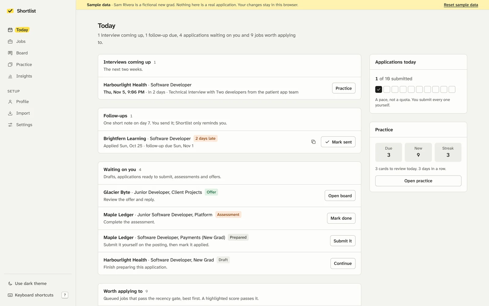
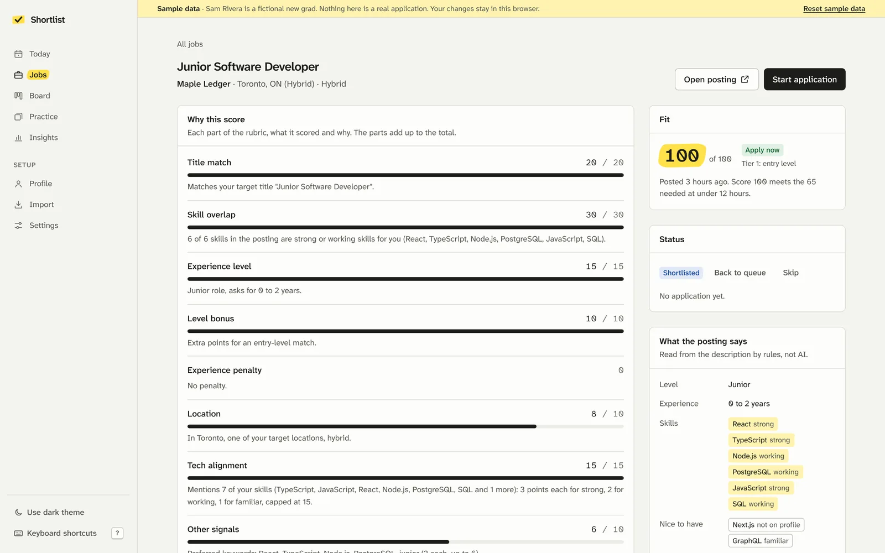
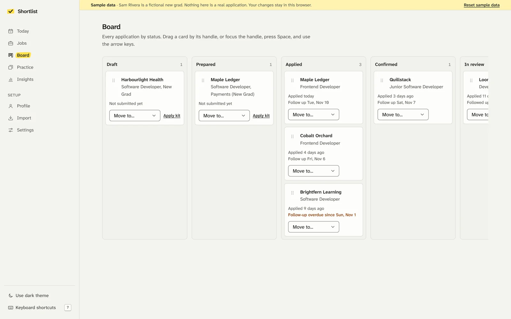
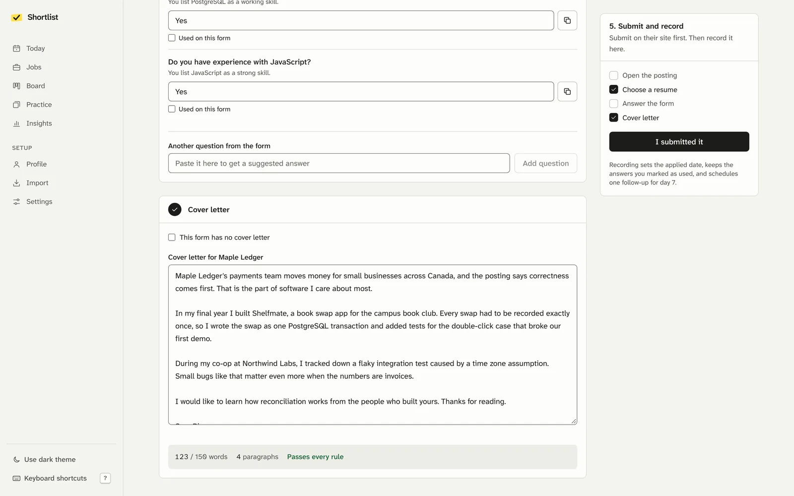
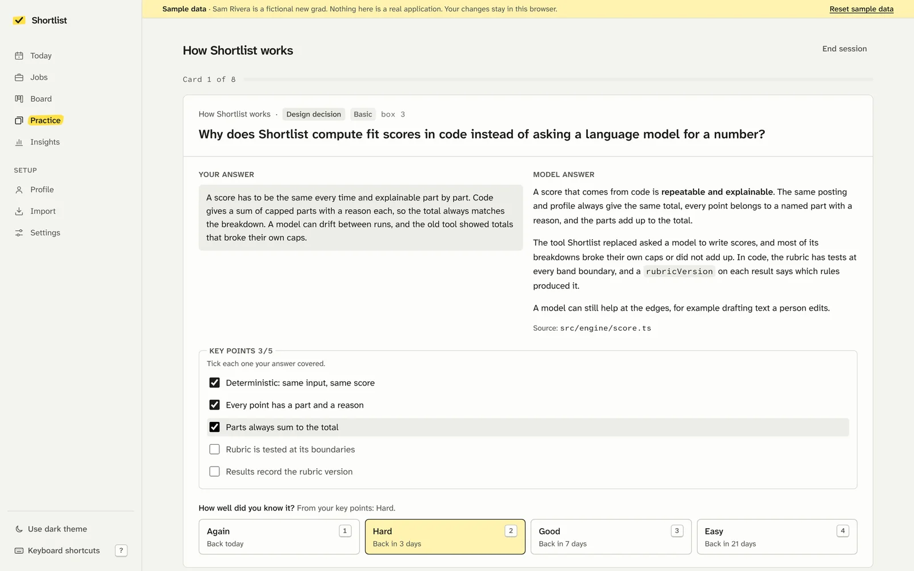
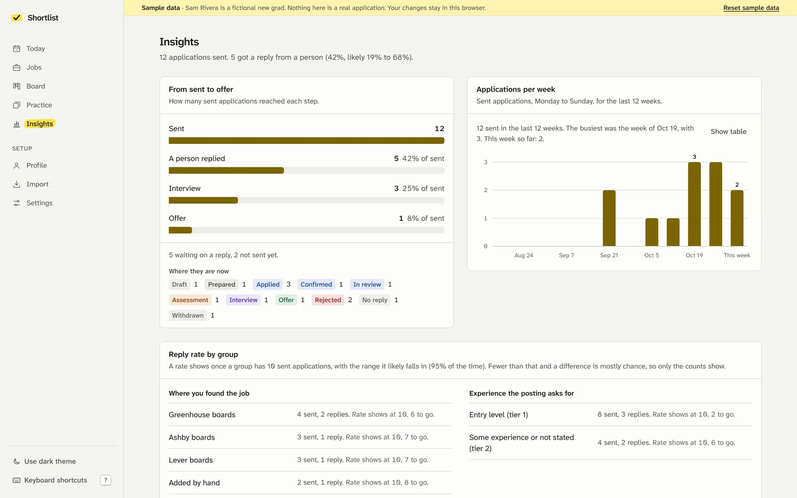
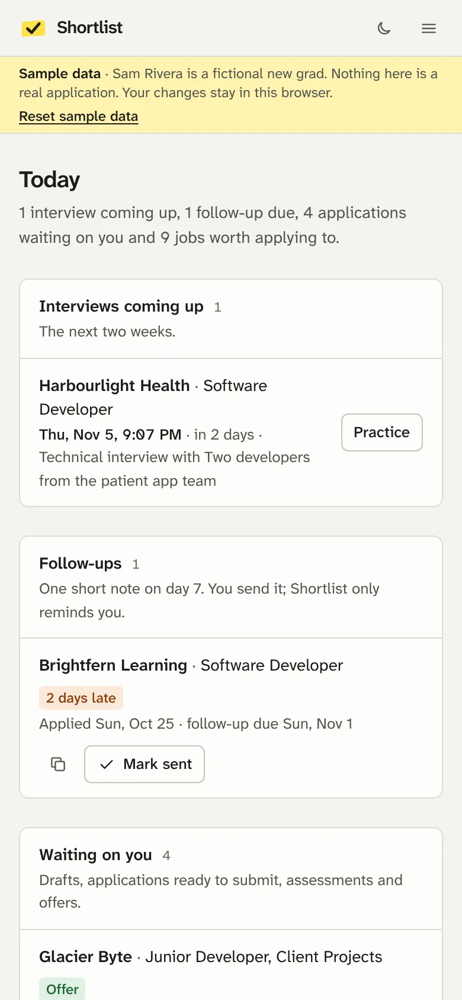
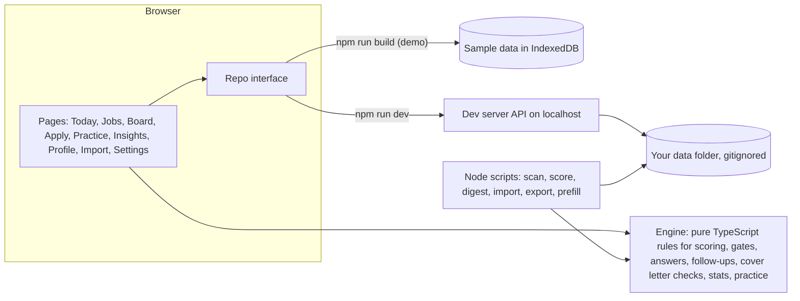

# Shortlist

A local-first job-search copilot for a new-grad software developer. It scores postings for fit and explains every point, prepares each application, checks the cover letter, reminds you to follow up, records what happened, and helps you practise explaining your own projects for interviews.

It never submits an application, never logs into anything, never automates LinkedIn and never stores a password. It prepares and explains; you decide and you click submit.



Every screenshot here uses the bundled sample data: Sam Rivera is a fictional new grad and the companies are made up.

## What it does

- **Jobs.** Add a posting by pasting its address and description, or let the board scanner find postings from company job boards. Each one gets a fit score from 0 to 100 with a reason for every part, and a verdict of apply, hold or skip that depends on how old the posting is.
- **Apply kit.** One page per application: open the posting, pick a resume version, copy suggested answers that each say where they came from, and write a cover letter that is checked as you type. When you have submitted it on their site, "I submitted it" records the date, the answers you used and the letter, and schedules a follow-up for day 7.
- **Today and Board.** Today lists what needs you: interviews, follow-ups that are due, drafts, assessments, offers and the queued jobs worth applying to. The board shows every application by status and only allows real status changes.
- **Practice.** Decks of interview questions, coding exercises and STAR stories. You explain an answer in your own words, compare it with the model answer and its source, then grade yourself; cards come back on a Leitner schedule.
- **Insights.** Counts from sent to offer, applications per week, and reply rates that only appear once a group has 10 applications, each with the range it likely falls in.
- **Import.** Brings in history from job-hunter, the older tool Shortlist replaces, after showing you every change first.

| | |
| --- | --- |
|  |  |
| **Why this score.** The parts always add up to the total. | **Board.** Drag, use the keyboard, or pick "Move to". |
|  |  |
| **Apply kit.** Answers to copy and a cover letter checked as you type. | **Practice.** Explain it back, then compare. |
|  |  |
| **Insights.** No rate until the sample can support it. | **On a phone.** Every page works down to 320 pixels wide. |

## You stay in the loop

Shortlist does the preparation and the bookkeeping. These stay with you, by design:

- Submitting every application, on the employer's own site.
- Any free-text answer, essay or cover letter. Shortlist suggests and checks; you write and approve.
- Salary, years of experience, sponsorship, demographic questions, and "do you have experience with X" when your profile does not settle it. The answer engine returns "you answer this" instead of guessing.
- Logins, passwords, verification codes and account creation. Shortlist has nowhere to store a password.
- Recruiter messages and follow-ups. It reminds you and can copy a draft note; you send it.
- Changing an application's outcome. A pasted email can suggest a status; you confirm it.

The optional form assistant (`npm run prefill`) opens one Greenhouse, Lever or Ashby form in a visible browser and fills only what it is sure of. It presses no keys and never submits; its only click is selecting a radio on the radio itself, after checking that the element is a radio and not inside a button or link. A test proves this against a synthetic form. It refuses LinkedIn and every other site.

## Quick start

Requires Node 22.13 or newer (or Node 24).

```sh
git clone https://github.com/abdelelgendy/Internship-app-tracker.git
cd Internship-app-tracker
npm install
```

### Sample mode: try it with fictional data

```sh
npm run build
npm run preview        # http://localhost:4173
```

The built app is a static site with no server. It copies the sample data into your browser's storage on the first visit, so your changes stay in that browser and nothing is uploaded. "Reset sample data" in the banner puts it back.

### Local mode: your own data

```sh
npm run dev            # http://localhost:5173
```

The dev server reads and writes a data folder on your computer: `.private/` in this repo by default, or wherever `COPILOT_DATA_DIR` points (set it in the shell or in `.env.local`). That folder is gitignored, and the dev server refuses a folder git would commit. The banner at the top always says which data you are looking at. Add `?data=sample` to the address to look at the sample data instead.

Turn on the commit guard once per clone:

```sh
git config core.hooksPath .githooks
```

Then add your profile on the Profile page (or import it, below) and start adding jobs.

### Optional: cover letter drafts with Claude

Set `ANTHROPIC_API_KEY` in `.env.local` and restart `npm run dev`. The apply kit then shows "Draft with Claude", which first shows you exactly what will be sent: the posting, your approved facts and your style rules, with email addresses and phone numbers removed. The key stays in the dev server's Node process and the public build contains none of this code. Without a key the button does not appear.

## Importing from job-hunter

Open **Import** in local mode, point it at the job-hunter folder (or its `copilot-data/` folder) and press **Preview import**. You see what would be added, how old statuses map to new ones, rows that disagree with each other, duplicates, rows set aside, and the exact files that would be written. Nothing is written until you press **Apply import**, and running it again adds nothing new. The command line does the same:

```sh
npm run import:jobhunter -- --from ../job-hunter --dry-run
npm run import:jobhunter -- --from ../job-hunter
```

The import only reads job-hunter. A profile you already have is kept unless you ask to replace it. If the folder has no `copilot-data/profile.json`, the old `config/profile.yaml` is used as a fallback: every job in it is marked unverified, every saved answer becomes "answer it yourself", project bullets are left out, and the preview lists all of them to check.

## Command-line tools

They run TypeScript directly with Node's type stripping and use the same engine as the app, so a score in the terminal matches the score on the page. Each takes `--data <folder>` and `--help`. Details in [scripts/README.md](scripts/README.md).

| Command | What it does |
| --- | --- |
| `npm run import:jobhunter` | Import job-hunter's history, practice and profile |
| `npm run scan` | Read the Greenhouse, Ashby and Lever boards on your watchlist and save new postings that fit |
| `npm run score` | Score every saved job again with the current rubric and clock |
| `npm run digest` | Write today's page as Markdown to `digest.md` in the data folder |
| `npm run export:csv` | Write your applications as a CSV file |
| `npm run prefill` | The optional form assistant described above |
| `npm run check:private` | The commit guard; `-- --all` checks every tracked file |

## Privacy

- Real data lives only in the data folder, which git ignores; the folder also ignores itself if moved into another repo. The repo and the public build only contain `sample-data/`.
- In local mode the app reaches your data through a small API inside the dev server that answers only this computer, under a localhost name, from the app's own pages, with a custom header other websites cannot send.
- The commit guard blocks a commit that contains any line from `denylist.txt` in your data folder, a phone number, an email address outside the example domains, or a demographic answer. It prints matches masked, so the check never shows the private value.
- Nothing leaves your machine unless you turn on Claude drafts, and then only what the dialog shows you.

The full model is in [docs/PRIVACY.md](docs/PRIVACY.md).

## How it is built



- **Engine** (`src/engine/`): the rules as plain functions with no DOM, file system or network, shared by the app and the scripts. Same input and clock, same answer, with a reason a person can read.
- **Data** (`src/data/`): one `Repo` interface with three implementations: the local API (dev), IndexedDB seeded with sample data (demo), and the read-only sample data itself.
- **Pages** (`src/features/`), the shell (`src/app/`) and shared components (`src/ui/`): React 19, React Router and Tailwind CSS, each page loaded on demand.
- **Import** (`src/jobhunter/`): the pure mapping from job-hunter's files, used by the Import page and the import script.
- **Scripts** (`scripts/`): Node command-line tools over the same data folder.

More in [docs/ARCHITECTURE.md](docs/ARCHITECTURE.md). The data format is [src/engine/types.ts](src/engine/types.ts), and every engine module is described in [src/engine/README.md](src/engine/README.md).

## Testing

```sh
npm test               # Vitest: engine, data layer, pages, scripts
npm run lint
npm run typecheck
```

- Every engine module has table-driven tests, including each rubric band at its boundary and each gate edge in hours.
- Pages are tested in jsdom with Testing Library, including keyboard use.
- The dev server's data API is tested against a real Vite server: it refuses other origins, path traversal and bodies over 10 MB.
- Each script runs end to end on a temporary copy of the sample data. The scanner uses saved board responses, so no test touches the network.
- The form assistant is tested in headless Chromium against a synthetic form, to prove it never clicks a submit control.
- The commit guard is tested in a temporary git repo, where it blocks a commit with a denylisted string and one with a phone number.

## Where it came from

This repo started as Abdel's first hand-written React and TypeScript app, a one-page internship tracker from February 2026, kept as it was in [docs/day-one](docs/day-one/README.md). Shortlist also replaces job-hunter, an earlier private experiment in which a language model applied job-search rules written in prose. Its scores often broke their own caps and its automation went further than it should have, so Shortlist keeps the useful rules, makes them code with tests, and leaves every decision that matters with a person.
