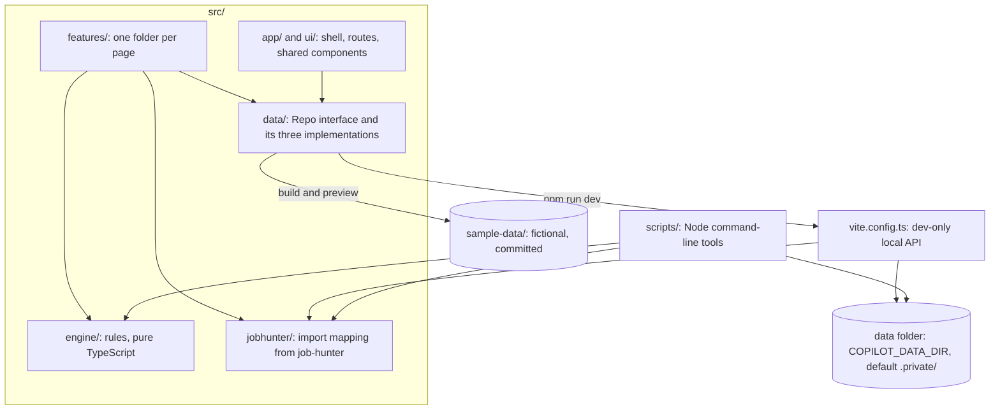

# Architecture

Shortlist is a React app plus a set of Node scripts that share one rules engine and one data format. There is no backend: in local mode the Vite dev server reads and writes a folder on your computer, and the public build is a static site that keeps sample data in the browser.

This page explains how the parts fit, why they are split this way, and where each guarantee is enforced.

## The pieces



| Folder | What lives there | May import |
| --- | --- | --- |
| `src/engine/` | Scoring, gates, facts extraction, dedup, states, follow-ups, answers, cover letter checks, inbox classifier, stats, practice scheduling, and the data contract `types.ts` | Only other engine files (enforced by ESLint) |
| `src/data/` | The `Repo` interface, the local API client, the IndexedDB demo store, the sample data loader, and the dev-server handlers that need no Node types | Engine |
| `src/jobhunter/` | The mapping from job-hunter's old files to the contract, the folder planner, and the list of files an import writes | Engine, data layout |
| `src/app/`, `src/ui/` | Shell, routes, navigation, theme, keyboard shortcuts, banner, and shared components | Data, UI |
| `src/features/` | Today, Jobs, Board, Apply, Practice, Insights, Profile, Import, Settings | Everything above |
| `scripts/` | `import-jobhunter`, `scan`, `score`, `digest`, `export-csv`, `prefill`, `check-private` | Engine, data layout, jobhunter, Node APIs |

## The engine: rules as code

Every decision Shortlist makes is a pure function in `src/engine/`: no DOM, no file system, no network, and the clock and time zone are parameters. The same input gives the same answer, with a reason a person can read. The React pages and the Node scripts import the same files, so a score in the terminal matches the score on the page.

- **Scores add up.** `score.ts` returns every part with its points, cap and reason. When the parts would leave 0 to 100, a final "Capped" part says by how much, so the total always equals the sum of the parts. A disqualified job scores 0 with a part that keeps the would-be score in its reason. Each result carries a `rubricVersion`.
- **Gates are checked when shown.** A stored score's apply, hold or skip verdict goes stale as the posting ages, so pages call `recencyGate` again with the current time instead of trusting what was saved. A job with no posting date is held until a person adds the date.
- **The answer engine says when it does not know.** `answerFor` returns null whenever a person must answer: salary, sponsorship, demographic questions, a saved answer marked "answer it yourself", or a skill question the profile does not settle. Skill questions come from a truth table over your skill levels and never default to "Yes".
- **State changes are explicit.** `states.ts` lists every allowed move for postings and applications. The board, the apply kit and Today go through `transition`, which refuses a move that is not allowed and appends to the history. The importer maps job-hunter's old statuses with `normalizeStatus` and reports any it does not know.
- **Rates wait for data.** `stats.ts` shows no rate below 10 outcomes and gives each rate a Wilson 95% interval.

Node 22 runs these files directly with `--experimental-strip-types`, so the scripts need no build step. That is why imports inside the engine use the `.ts` extension and only erasable TypeScript syntax is allowed. Each module is described in [src/engine/README.md](../src/engine/README.md).

## Data: one interface, two modes

Every page reads and writes through the `Repo` interface (`src/data/repo.ts`), using `useRepoData(key, load)` to read and `useRepo()` to save. A save tells mounted views to load again, so the board, Today and the job pages stay in step.

`main.tsx` picks the implementation before the first render:

| Mode | When | Implementation | Where data lives |
| --- | --- | --- | --- |
| Local | `npm run dev` | `localApiRepo.ts`, calling `/__local/*` | Your data folder |
| Sample | `npm run build` and `npm run preview`, or `?data=sample` in dev | `browserRepo.ts` over IndexedDB, seeded from `sampleRepo.ts` | This browser only |

The production build never contains the local API client or the dev-server handlers: the local branch sits behind `import.meta.env.DEV`, which Vite removes from the build. When the browser refuses IndexedDB (some private windows), the demo falls back to memory and the banner says changes last until reload. The sample data's timestamps are moved forward to the present on load, so "posted 3 hours ago" stays true on any day.

### The data folder

The layout is fixed by the contract in [src/engine/types.ts](../src/engine/types.ts):

```
profile.json                 the profile, saved answers and approved facts
jobs.jsonl                   one posting per line
applications.jsonl           one application per line
companies.json               the scanner's watchlist
practice/decks/<id>.json     one deck per file
practice/exercises.json
practice/stories.json
practice/progress.json
covers/<applicationId>.md    cover letters
denylist.txt                 strings the commit guard blocks
```

JSONL rows are saved by id: the last line for an id is current, and a save keeps any line it cannot read. Every write goes to a temporary file that is renamed over the target, so a reader never sees half a file. The first open creates the layout with private permissions and a `.gitignore` containing `*`.

## The dev server's local API

In local mode the browser cannot touch the file system, so `vite.config.ts` adds three handlers to the dev server, all under `/__local`:

| Route | Handler | Purpose |
| --- | --- | --- |
| `/__local/import/preview` | `src/data/import-middleware.ts` | Plans an import from a job-hunter folder, read-only |
| `/__local/ai/*` | `src/data/ai-middleware.ts` | Optional cover letter drafts with Claude |
| `/__local/status`, `files`, `rows`, `list` | `createLocalDataHandler` in `vite.config.ts` | Reads and writes the data folder |

Every handler first runs `localRequestRefusal` (`src/data/localApi.ts`): the request must come from this computer, under a localhost host name, from the app's own origin, with a custom header. The loopback check stops other machines if the server runs with `--host`, the Host check stops DNS rebinding, and the origin check and the header stop other websites open in the same browser, including other dev servers on localhost. The data handler also serves only the contract's files, rejects path traversal (encoded or not) and bodies over 10 MB, runs writes to one file one at a time, and refuses a data folder that git would commit.

The file helpers (`createLayout`, `writeAtomic`, `gitWouldCommit`, `loadData`) live in `scripts/lib/data-dir.ts` and are shared by the dev server and the scripts, so both follow the same rules.

All of this is registered with `apply: 'serve'`, so none of it exists in `vite build` or `vite preview`.

### Claude drafts

The draft handler accepts only the posting, the profile's approved facts and the cover letter style rules, drops every other field, and removes email addresses and phone numbers before calling the API. The page shows exactly that payload before anything is sent. The key comes from `ANTHROPIC_API_KEY` and stays in the Node process. One draft runs at a time. The result is a draft in the editor, checked by `coverLint` like anything you type.

## Import from job-hunter

`src/jobhunter/` holds the only mapping from job-hunter's files to the contract:

- `map.ts` reads the old queue and application log (several row shapes) plus any contract-shaped files in `copilot-data/`, and returns an `ImportPlan`: what to add, what is already there, how statuses map, mismatches, duplicates, rows set aside and problems. It is pure and deterministic: ids come from job-hunter's own ids or a hash of the row, so a second import adds nothing.
- `plan.ts` reads a folder through an injected reader, calls `map.ts`, and falls back to `config/profile.yaml` when `copilot-data/profile.json` is missing, marking everything from it as unverified.
- `writes.ts` turns a plan into the ordered list of files to write: jobs before the applications that point at them, and the profile only when Shortlist has none or you asked to replace it.

The Import page previews through the dev server and applies `writes.ts` through the local API. The `import:jobhunter` script runs the same planner and writes the same list straight to disk. In the demo, the Import page runs `map.ts` over a fictional job-hunter folder bundled with the app.

## Scripts

The scripts in `scripts/` run with Node's type stripping and work on the same data folder, found the same way as the dev server (a `--data` flag, then `COPILOT_DATA_DIR` from the shell, `.env.local` or `.env`, then `.private/`).

- `scan` calls the public Greenhouse, Ashby and Lever board APIs from Node, which avoids browser CORS limits, then filters, scores and deduplicates with the engine.
- `prefill` drives one application form in a visible Playwright browser. Its page code fills fields and has no click, key press or submit call; any button or submit control throws. It refuses every host but the three ATS form hosts, matched by hostname.
- `check-private.mjs` is plain JavaScript so the pre-commit hook needs nothing but Node and git.

## Pages

Each page under `src/features/` exports one component with the same name as its file, and `src/app/routes.tsx` loads it on demand. Pages share the components in `src/ui/` (buttons, dialogs, tabs, badges, toasts) and the color tokens in `src/index.css`; Tailwind's default palette is switched off so every color comes from a token that has a dark theme value. Layout tiers are base, `sm`, `md` and `xl`, and every page is checked at 320, 390, 768, 1280 and 1920 pixels for sideways scrolling.

## Testing

| Layer | How |
| --- | --- |
| Engine | Table-driven Vitest tests next to each module, including every rubric band and gate edge |
| Data layer | Unit tests for JSONL, layout and repos; the local API against a real Vite server |
| Pages | Testing Library in jsdom, including routing, keyboard shortcuts, dialogs and focus |
| Import | The mapping on a fictional job-hunter folder; the endpoint and the script end to end on temporary folders |
| Scripts | Each command end to end on a temporary copy of `sample-data/`, with saved board responses instead of the network |
| Form assistant | Headless Chromium against a synthetic form, proving no submit control is ever used |
| Commit guard | A temporary git repo where the hook blocks a denylisted string and a phone number |

Run them with `npm test`, plus `npm run lint` and `npm run typecheck`.

## Known limits

- The dev server and the scripts serialize writes to a data file with a shared `<file>.lock`, and a stale write is refused, not merged: if a script changes a row while a page has it open, the page's next save of that row fails, the page reloads, and the person makes the change again. A crashed process can leave a lock behind; it is removed after 15 seconds.
- The recency gate is gentler than job-hunter's. job-hunter skipped every posting older than 72 hours; new-grad postings often stay open for weeks, so Shortlist keeps the 72-hour bars only for "apply now", holds older postings up to 30 days with a reminder to check they are still open, and skips them after that unless a person marked them as checked. The limit is `targeting.maxPostingAgeDays` in the profile.
- The daily application target uses the default of 10 per weekday; there is no setting for it yet.
- The scanner's board parsers are tested against saved responses; a live run is the first check against each board's current API.
